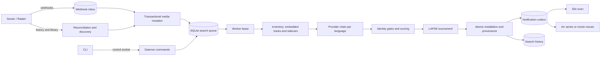

# Architecture

subsyncd is a headless, SQLite-authoritative subtitle acquisition service. Sonarr and Radarr supply media identity and lifecycle events; language-specific provider chains supply candidates; inventory, scoring, LAPSE and atomic installation form the processing pipeline; Silo scans and Arr rescans are notified afterwards. There is no management HTTP API or browser UI: operators use the CLI, which talks to the running daemon over a local control socket.

Each package's responsibility is listed in the [package map](development/README.md#package-map).

## Processes and entry points

| Entry point | Role |
| --- | --- |
| `subsyncd serve` | The daemon: HTTP server (`/healthz`, `/readyz`, webhooks), webhook inbox processors, the worker, the managed webhook connection, and the control socket |
| Routed commands (`search`, `reject`, `scan`, `retry`) | Sent to the daemon over `<data_dir>/subsyncd.sock`; run in process with the lock when no daemon runs |
| Read-only commands (`explain`, `find`, `missing`, `coverage`, `recent`, `status`, `providers`, `doctor`, `analyze-sync`, `webhook-url`, the `forget-instance` preview) | Open the database read-only beside the daemon |
| Stop-first commands (`rotate-webhook-token`, `forget-instance --yes`) | Take the process lock, so the daemon must be stopped |

See [Queue and control](development/queue-and-control.md#routed-and-read-only-commands).

## Startup

Startup and readiness are local and offline: they need no Arr, provider or Silo access, run no full-library scan and do no backfill. Startup fails only for invalid configuration, unsafe or missing local roots, SQLite open or migration errors, a missing `ffprobe`, or an incompatible LAPSE.

A mutable start takes the data-directory lock, applies migrations, ensures webhook tokens, settles interrupted installs and rollback copies, and adds searches for newly configured languages, all from local state. Arr traffic begins only afterwards, in background work: reconciliation, library discovery and the managed webhook connection sync. Their failures are scheduled and logged and never affect readiness. `/readyz` checks SQLite and the media roots.

## Durable state

SQLite is authoritative for media state, scheduling, leases, cursors, provider availability, rejections, provenance, notifications and history. Related state transitions are atomic and owner-guarded.

| Area | Tables |
| --- | --- |
| Catalog | `instances` (cursor, reconcile timing, discovery scope, webhook token and managed connection), `media`, `events`, `reconciliation_replays`, `webhook_inbox` |
| Inventory | `tracks`, `inventory_probes`, `media_hashes` |
| Queue | `search_states` |
| Providers | `provider_states`, `provider_cache`, `pack_cache`, `pack_members`, `candidates` |
| Decisions | `candidate_rejections` (system and user), `candidate_lapse_failures` |
| Publication | `installations`, `pending_installs`, `notifications` |
| History | `search_history` (30 days) |

Finished notifications are pruned after 30 days, and search history after 30 days. The table list, data-directory layout and migration index are in [Persistence](development/persistence.md).

## Catalog flow

Webhooks and periodic Arr reconciliation converge on one transactional media-mutation helper. It records an idempotent audit event, applies an import, rename, upgrade or deletion, invalidates stale evidence when content changes, and updates every configured language's search.

- A webhook is answered once it is stored in the inbox. One processor per instance applies stored webhooks in arrival order, retries failures, and resumes after a restart. A late or retried upsert cannot revive a row deleted after it.
- Reconciliation reads descending 100-record history pages per instance every six hours, reduces them by stable entity, and commits all mutations with the cursor in one transaction. It withholds snapshot deletions that look like an emptied or foreign Arr database.
- Library discovery enumerates each instance's in-scope files once per scope, additively.
- With `server.webhook_base_url` set, a maintainer creates, adopts and repairs each instance's Arr webhook connection.

The catalog keeps two identities. `entity_id` is the stable movie or episode and survives file replacement; `file_id` is the current physical Arr file and is part of fingerprints, webhook events, installations and hashes. An upgrade therefore updates one media row while invalidating evidence tied to the old bytes.

Path mapping is a scope boundary: unmapped media is ignored, while traversal and unsafe resolution fail closed. Details: [Reconciliation](development/reconciliation.md).

## Search queue

Search states are the queue. Dispatch order is class (import, missing, upgrade), then instance `queue_priority`, then a durable queue position that throttles do not reset, then media order (title, series, season with specials last or a movie's year, episode).

- Provider cooldowns and the missing, failure and upgrade schedules decide when work is due ([Scheduling](development/providers/scheduling.md)).
- The worker leases nothing for a language and media kind while every provider on that route is unable to download.
- Advisory wakes reduce latency but carry no correctness: polling always rediscovers due work.
- A change arriving during a lease keeps the owner, coalesces one rerun, and prevents a stale completion from restoring old progress.
- After a cooldown, providers that already answered cleanly are skipped while their answers are younger than the missing schedule's next gap (6 hours for a new import, longer as attempts grow; see [Resume progress](development/providers/limits.md#resume-progress)).

## Leases, shutdown and locking

- Workers lease only free slots, filtered to configured routes and active media. Leases last five minutes, are renewed every minute, and are completed by owner compare-and-swap. An expired lease counts as unleased everywhere.
- Shutdown stops new acquisition, waits a fixed 30-second window, cancels active work, waits one more 30-second window, then returns even if a dependency ignores cancellation. Work that returns canceled gives its lease back; work that never returns keeps its lease until it expires.
- Mutating assembly takes the data-directory lock before migrations and keeps it until close. Read-only assembly validates a current-schema database without writing and can read the running daemon's WAL.

See [Queue and control](development/queue-and-control.md).

## Media support boundary

Media fingerprints bind path, Arr file ID, size and modification time. Embedded inventory requires a completed-probe marker; sidecars are scanned live before every search. Expensive file hashes are cached against the exact fingerprint.

A Sonarr file covering several consecutive episodes of one season is a range target; every candidate must cover the whole range, and the subtitle must reach 75% of the runtime. Files whose episodes span seasons, leave gaps or lack numbers stay `unsupported_multi_episode` with terminal searches.

## Acquisition and publication

Each language owns an ordered provider chain with a preferred and a fallback tier. Candidates pass identity gates and release scoring before any download. Exact hashes install directly; strong first installs may bypass LAPSE by policy; other candidates enter the lazy score-tier LAPSE tournament, where each candidate is synchronized once and the winning artifact installs without another run. Deterministic candidate failures are retained as rejections; operational failures stay retryable. See [Providers and matching](development/providers/README.md).

Installation validates and stages a sidecar beside its destination, fsyncs and publishes it atomically (hard link for a fresh file, rename for a managed replacement), fsyncs the directory, and commits checksum-bound provenance with its notification intents. A pending-install record spans publication to commit, so startup can undo a publication a crash left unrecorded. A managed replacement's rollback copy lives only until the installation is recorded. User-owned or changed sidecars are never overwritten. See [Installation safety](development/installation-safety.md).

A committed install, removal or sidecar move queues notification intents in the same transaction: a Silo folder scan for installs and removals, and a rescan of the owning Sonarr series or Radarr movie (per instance `rescan_after_changes`, default on) for all three. Delivery is asynchronous and retried, so a notification failure never rolls back a subtitle. See [Notifications](development/notifications.md).
